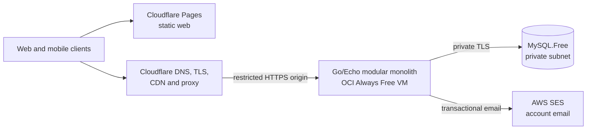

# Ostos architecture and product blueprint

Status: proposed baseline  
Last verified: 2026-10-12  
Target: a small, city-scoped grocery collaboration product for family and friends

## 1. Executive decision

Ostos should begin as a single deployable Go modular monolith, two purpose-built React clients, and managed MySQL. It should not begin as microservices, a Next.js server, an exhaustive supermarket catalog, or a repository-wide collection of `handlers`, `services`, and `repositories`.

| Area | Decision |
| --- | --- |
| Web | React, Vite, TanStack Router, TanStack Query, deployed as static assets on Cloudflare Pages |
| Mobile | Expo, React Native, Expo Router, TanStack Query, SQLite for durable offline work |
| Backend | Go 1.27, Echo v5, OpenAPI, GORM for MySQL mapping/querying, and explicit transactions |
| Code shape | Modular monolith by business capability, with local transport/application/persistence separation |
| Database | OCI Always Free `MySQL.Free` in a private subnet; do not enable the HeatWave accelerator initially |
| Authentication | Ostos-managed credentials and sessions; authorization and Family roles remain database-backed |
| Media | Excluded initially; future application objects may use OCI Object Storage after the feature exists |
| Edge | Cloudflare DNS/TLS/CDN proxy for the API and Pages for the later web build |
| Compute | One Always Free AMD E2 Micro VM running the API container |
| Provisioning | Terraform for OCI resources; Ansible for the VM, Docker/Compose, certificates, and deployment |
| Synchronization | Read-only mobile cache with explicit stale/offline state; mutations require the API |
| Real time | Refresh on lifecycle/user events; no Redis, WebSockets, or polling infrastructure initially |

This plan deliberately optimizes for correctness, low operational weight, and an actual zero-dollar cloud footprint at the stated family-and-friends scale. Zero dollars does **not** provide production-grade availability: the free database is single-node and the application has one origin VM.

## 2. Goals, constraints, and non-goals

### Goals

- A complete authenticated experience on both the website and mobile app.
- A user can create a Family or accept a Family invitation.
- Every Family has exactly one Owner and one shared current grocery list.
- Family members can plan a list, mark collected items, record quantities and amounts paid, and complete the list into immutable purchase history.
- Completion explicitly keeps or discards unchecked items.
- Trips retain immutable history, including the selected supermarket branch.
- The mobile shopping flow remains usable through weak or absent supermarket connectivity.
- The design can later absorb a curated city catalog and retailer integrations without corrupting the original shopping history.
- OCI infrastructure is reproducible with Terraform and VM state is reproducible with Ansible.

### Hard constraints

- OCI consumption must remain inside Always Free allowances.
- The database endpoint is private and never internet-accessible.
- Cloudflare is the public edge.
- Go/Echo is the sole application backend and authority for business rules.
- There is no permanent cloud staging database because Always Free supplies one HeatWave DB system.
- The initial audience is a small trusted group, not tens of thousands of concurrent users.

### Deliberate non-goals for the MVP

- Tracking every product or live stock position in every supermarket.
- Public price comparison, recommendation, or route optimization.
- Receipt OCR, automatic invoice import, or loyalty-card integration.
- Multiple lists per Family.
- Multiple cities, currencies, or tax regimes.
- Microservices, Kubernetes, Kafka, Redis, Elasticsearch, or event sourcing.
- HeatWave analytics merely because the free shape exists.

## 3. Pushback and design corrections

### 3.1 Next.js is capable, but it is the wrong default here

Next.js is not automatically a giant client bundle. It performs route-level splitting and can statically export HTML. The mismatch is architectural:

- A dynamic Next runtime would add a JavaScript server, React Server Component boundaries, cache rules, and often a frontend BFF beside the Go API.
- Most authenticated Ostos screens are interactive, offline-oriented client screens. They receive little value from server components.
- Static Next export removes the runtime, but request-dependent features disappear and unknown paths such as invitation tokens and trip IDs become awkward.
- The main public SEO surface is initially a handful of stable pages, not thousands of changing product pages.

Use Vite and TanStack Router for the app. Explicitly enable TanStack Router's automatic code splitting and keep the root route small. The root redirects based on authentication, and Cloudflare Pages must serve the SPA shell for direct navigation to `/app/*` and authentication routes. Public marketing, terms, privacy, and support routes are deferred until required.

Reconsider SSR only when public, frequently changing product/store/price pages become an acquisition channel. At that point, a separate public catalog frontend could justify Next.js or a stable TanStack Start release. As of this review, TanStack Start remains a Release Candidate even though its API is described as stable; it should not silently become a second backend.

References: [TanStack Router code splitting](https://tanstack.com/router/latest/docs/guide/code-splitting), [Next.js SPA/static export guidance](https://nextjs.org/docs/app/guides/single-page-applications), [TanStack Start status](https://tanstack.com/start/latest/docs/framework/react/overview), [Vite multi-page builds](https://vite.dev/guide/build#multi-page-app).

### 3.2 Separate concerns locally, not across global junk drawers

The objection is not to layers. It is to repository-wide `handlers/`, `services/`, `repositories/`, and `models/` directories.

A feature such as “complete a shopping trip” changes its HTTP contract, permissions, transaction, queries, and tests together. Global horizontal folders scatter that cohesive change across the repository. As the code grows, `services` becomes a god package, `models` becomes an anemic shared schema, and unrelated handlers sit together only because they all speak HTTP.

The chosen compromise is a modular monolith:

- Organize top-level application code by business capability.
- Preserve transport, application, domain, and persistence boundaries inside each capability.
- Keep cross-cutting technical adapters under `platform`.
- Keep repository interfaces narrow and owned by the use case that consumes them.
- Keep Echo DTOs, GORM persistence mappings, and external provider payloads out of domain types.

This retains the readability the horizontal design is trying to achieve while making a business change local and reviewable.

### 3.3 Do not promise “all supermarket items”

A supermarket's full assortment is not a static dataset that Ostos can infer. It changes by branch, time, provider, promotions, and stock state. Absence from an API response does not prove out-of-stock.

The product should work with freeform list entries on day one. Build the city catalog incrementally from admin curation, barcode scans, completed purchases, and retailer feeds. Price comparison must use exact, reviewed product variants and fresh provenance—not fuzzy matches between labels such as “soap.”

### 3.4 Make offline limits explicit

Supermarkets are precisely where connectivity is unreliable. The first release persists the last successful private snapshot, shows its age, and remains readable after process death. It does not queue offline mutations; mutation controls must fail or remain disabled before the UI claims success. A durable command outbox is a later decision, not an implied capability.

### 3.5 “Always Free” is not “highly available”

The current OCI free offering makes this topology possible, including HeatWave. It does not provide an SLA, HA, read replicas, point-in-time recovery, or a project-managed recovery guarantee. This limitation must remain explicit; provider protections must stay enabled.

## 4. System context



Suggested hostnames:

- `example.com`: public pages and the web application under `/app`.
- `www.example.com`: permanent redirect to the apex.
- `api.example.com`: proxied Cloudflare DNS to the VM's restricted HTTPS origin.

The actual purchased domain replaces `example.com` everywhere. Public pages and the authenticated app can share one Pages deployment; “static hosting” describes deployment, not the capability of the React application.

## 5. Repository layout

```text
/
  AGENTS.md
  ARCHITECTURE.md
  api/
    openapi.yaml
  backend/
    cmd/api/
    internal/
      accounts/
      families/
      shopping/
      apierrors/
      config/
      platform/
      repository/mysql/
      transport/http/
  migrations/
    cmd/migrate/
    sql/
  mobile/
  web/                       # Created in implementation step 7.
  infra/
    terraform/
      bootstrap/
      environments/prod/
      modules/
    ansible/
      inventories/
      roles/
      playbooks/
  docs/
    adr/
    runbooks/
```

The generated TypeScript API client lives with the OpenAPI contract until the client workspaces exist. Do not add a monorepo task runner until task orchestration is measurably painful.

One representative Go feature starts shallow:

```text
internal/shopping/
  list_item.go         # domain types and invariants
  trip.go
  trip_item.go
  policy.go            # capability checks
  service.go           # use cases and transaction boundaries
  repository.go        # narrow interfaces consumed here
internal/transport/http/
  handler/
  request/
  response/
  router/
  validation/
internal/repository/mysql/
  shopping.go
  mysql/
    repository.go
    queries.sql
```

Dependency rules:

- `domain/application` code does not import Echo, MySQL drivers, SES, Cloudflare, or OCI SDK types.
- HTTP handlers map generated OpenAPI types and dedicated request DTOs to application commands.
- `internal/repository/mysql` implements interfaces owned by capabilities; GORM never performs migrations.
- Cross-feature calls use narrow application interfaces, not direct table access.
- `cmd/api/main.go` is the composition root and performs dependency wiring.
- No generic `Repository[T]`; transactions and query shapes are business-specific.

## 6. Frontend architecture

### 6.1 Web

Use:

- React with strict TypeScript.
- Vite.
- TanStack Router with file-based routes and `autoCodeSplitting: true`.
- TanStack Query for server state.
- React Hook Form plus runtime validation for forms.
- DOM-native accessible components; a small Radix-based design system is reasonable.
- IndexedDB only when durable web offline mutation support is implemented; do not mistake a persisted query cache for a synchronization engine.

Keep maps, charts, barcode tooling, admin screens, and image editors out of the root route and shared barrels. Enforce a production bundle budget in CI.

Public pages should contain useful HTML without JavaScript. Authenticated and token-bearing pages must send `noindex` metadata and a strict `Referrer-Policy`.

Commit a Cloudflare Pages `_redirects` file with the SPA fallbacks; do not redirect public HTML entries through the app shell:

```text
/app/*    /app/index.html  200
/auth/*   /app/index.html  200
/invite/* /app/index.html  200
```

### 6.2 Mobile

Use Expo rather than raw React Native CLI:

- Expo Router for file-based native routing and deep links.
- TanStack Query with native focus/network integration.
- `expo-sqlite` for the last successful Family/list snapshot and its refresh timestamp. There is no mutation outbox.
- OS secure storage through the auth SDK for credentials; never put tokens in SQLite.
- Platform-specific UI where native conventions differ.
- Development builds once native camera/barcode or other native modules require them.

Expo Router supplies typed routes, deep-link support, production lazy evaluation, and static web support. Ostos should still keep a DOM-native web app because desktop tables, keyboard use, accessibility, and later catalog administration deserve web-specific UI.

References: [Expo Router](https://docs.expo.dev/router/introduction/), [Expo monorepos](https://docs.expo.dev/guides/monorepos/), [Expo SQLite](https://docs.expo.dev/versions/latest/sdk/sqlite/).

### 6.3 Sharing boundary

Share behavior, contracts, and tokens—not entire screens.

Share:

- OpenAPI-generated request/response types and transport helpers.
- Query keys and platform-neutral query option factories.
- Money, quantity, unit, date, and display helpers.
- Offline command definitions and conflict rules behind storage adapters.
- Translation keys, design tokens, and test fixtures.
- UI permission hints, while always re-enforcing authorization on the server.

Do not share:

- Router trees.
- Full screens.
- DOM and React Native widgets.
- Camera, notifications, secure storage, service-worker, or filesystem implementations.

## 7. User-facing routes

Public routes:

```text
/
/features
/privacy
/terms
/support
/auth/sign-in
/auth/sign-up
/verify-email
/forgot-password
/reset-password
```

Authenticated routes:

```text
/app
/app/families
/app/families/new
/app/families/:familyId/list
/app/families/:familyId/shop
/app/families/:familyId/trips
/app/families/:familyId/trips/:tripId
/app/families/:familyId/members
/app/families/:familyId/invites
/app/families/:familyId/settings

/app/products
/app/products/:productId
/app/products/:productId/variants/:variantId
/app/supermarkets
/app/supermarkets/:storeId

/app/settings/profile
/app/settings/security
/app/settings/notifications

/app/admin/catalog
/app/admin/supermarkets
/app/admin/integrations
/app/admin/suggestions
```

`/app` redirects to the last active Family's list, the Family chooser, or onboarding. Planning (`list`) and in-store execution (`shop`) are different routes and chunks because their interactions and offline requirements differ.

Native route groups should preserve equivalent deep-link paths while using native stacks/tabs. Invitation, product, store, and trip links must open the corresponding native screen when installed and fall back to the website. Serve Apple and Android association files from the static site.

## 8. Domain language and catalog model

Do not use “item” for every concept. It hides the distinctions that price comparison depends on.

| Concept | Example | Meaning |
| --- | --- | --- |
| Category | Personal care → soap | Taxonomy, browsing, generic icon |
| Brand | Dove | Consumer-facing brand |
| Organization | Unilever | Optional owner/manufacturer of brands |
| Product | Dove Original Beauty Bar | Branded product family |
| Variant/trade item | 4 bars × 90 g, GTIN X | Exact sellable package |
| Retailer listing | Retailer API product `93842` | Provider-specific representation |
| Branch assortment | Store A lists variant X | Time-stamped availability assertion |
| Offer | R$14.99, loyalty required, valid today | Store/time/promotion-specific price |
| List entry | “soap, Dove if available, 2 packs” | Family intent; may remain freeform |
| Trip entry | What was requested and actually bought | Immutable purchase-history snapshot |

### Direct answers to the product questions

- “Soap” should be a generic category/request, not a single catalog product.
- A brand is a first-class entity. A manufacturer/company may own one or more brands and should remain a separate optional entity.
- Bottle or pack size belongs to the exact product variant. Coca-Cola PET 2 L and 6 × 350 mL are different variants, normally with different GTINs.
- Desired purchase count and package content are different quantities. “Three 2 L bottles” is `3 ea` of a variant whose package content is `2 L`.
- A freeform entry must always be allowed. Missing catalog data must never block someone from adding “soap.”
- A purchase can resolve a generic request to the exact variant actually bought.

GS1 describes GTIN as identifying a trade item that can be priced, ordered, or invoiced. It is the preferred exact-match key when a valid barcode is available. See [GS1 GTIN](https://www.gs1.org/standards/id-keys/gtin).

### Product attributes

Normalize attributes required across categories:

- `brand_id`
- `category_id`
- `units_per_package`
- `unit_content_value`
- `unit_content_unit`
- `package_type`
- `selling_mode` (`each`, `variable_weight`, and so on)
- validated identifiers such as GTIN

Keep rare category-specific attributes in schema-validated JSON initially. Promote one to a real indexed column only when filtering, matching, or comparison needs it. Do not create a generic EAV database.

### Images and icons

Use this fallback order:

1. Exact variant photo.
2. Product-family photo.
3. Curated category icon.
4. Generated neutral placeholder.

Images are excluded from the initial product. If later approved, store bytes in OCI Object Storage and metadata in MySQL: object key, content hash, MIME, dimensions, alt text, source, license, moderation status, and associations. Validate magic bytes and dimensions, strip EXIF, re-encode thumbnails, and deduplicate by content hash. Do not scrape or hotlink retailer images without contractual rights.

## 9. Family membership and permissions

The frozen Family roles are Owner, Manager, and Member. Owner is represented only by `families.owner_id`; Manager and Member use membership rows.

| Capability | Owner | Manager | Member |
| --- | ---: | ---: | ---: |
| View Family, list, and trips | Yes | Yes | Yes |
| Add/edit/remove/check list entries | Yes | Yes | Yes |
| Edit or complete the shared list | Yes | Yes | Yes |
| Invite/remove Members | Yes | Yes | No |
| Edit Family settings | Yes | Yes | No |
| Invite/promote/demote Managers | Yes | No | No |
| Transfer ownership or delete/archive Family | Yes | No | No |
| Edit global product/store catalog | Separate platform permission | Separate platform permission | No |

Invariants:

- A Family has exactly one Owner.
- The Owner cannot leave or be removed until ownership is transferred.
- A Manager cannot alter the Owner or another Manager.
- An invitation is revocable and expiring, targets an exact existing User, and always creates a Member.
- Invitation rows contain no bearer secret; account verification and password-reset bearer tokens are stored only as hashes.
- Accepting an invitation and creating membership is one database transaction.
- Every Family-scoped query constrains both actor membership and `family_id`; opaque IDs are not authorization.
- Platform catalog administration is independent of Family ownership.

`families.owner_id` is the sole Owner relationship; an Owner never has a membership row. Transactions, composite constraints, and row locks preserve exactly one Owner and the ten-Family-per-User limit.

## 10. Onboarding and invitation flow

1. The User registers an Ostos account and verifies their email.
2. The client logs in and stores the short-lived access JWT and rotated opaque refresh token in operating-system secure storage.
3. It loads the User's Families and pending invitations.
4. With no membership, the UI offers “Create Family” and “Accept invitation.”
5. Creating a Family stores its sole Owner in `families.owner_id`; Owner responses are synthesized and no Owner membership row is inserted.
6. Owners and Managers invite an existing account by exact lowercase username or exact Snowflake User ID.
7. The invited User accepts or declines the pending invitation by its Snowflake ID.
8. Acceptance rechecks expiry and the Family limit and creates the membership atomically.

## 11. Shopping lifecycle

There is one implicit current list per Family. A shopping trip exists only as an immutable historical result created when a list with at least one checked item is completed.

Rules:

1. Checking and unchecking are explicit desired-state updates, never toggle commands.
2. A checked entry may record actual purchased quantity and an authoritative nonnegative line total.
3. Unchecking clears temporary purchased quantity and cents.
4. Completion requires a default unchecked action of `keep` or `discard`; per-entry overrides may replace it.
5. Completion locks the Family and current items in stable order and atomically copies checked items into immutable history, removes them from the current list, retains kept unchecked items, and deletes discarded unchecked items.
6. A zero-purchase completion applies keep/discard without creating an empty trip header.
7. There are no start, status, active-trip, cancel, or reopen operations.

Race behavior:

- List mutations and completion serialize on the Family/current rows so racing work is included in completion or remains current, never partially lost.
- An item mutation racing with deletion returns `404 LIST_ITEM_NOT_FOUND`.
- List-item changes use last database commit wins; there are no item versions or conditional write headers.

Store selection should be strongly prompted but not a hard completion blocker. If no branch is selected, retain the family's spending history but do not publish a store-specific price observation.

## 12. Money, quantity, and product matching

- Store paid amounts as nonnegative signed 64-bit BRL cents, never floating point. For example, R$17.98 is `1798`. A currency column is unnecessary until multi-currency support exists.
- Store measurable quantities as fixed-precision decimals and serialize their JSON values as strings.
- Keep the requested quantity, purchased package count, and package content separate.
- Convert only within compatible dimensions: grams to kilograms is valid; count to kilograms is not.
- Treat the line total as authoritative for purchase history. A displayed unit price may be derived with explicit rounding.
- Preserve promotion conditions such as “3 for R$20,” loyalty requirements, and validity windows. Do not flatten them into an unconditional unit price.

Provider product matching order:

1. Valid exact GTIN.
2. Existing human-reviewed provider-ID mapping.
3. Normalized brand/name/package candidates.
4. Manual review.

Never auto-merge products merely because titles look similar. A wrong merge makes price comparison deceptive.

## 13. Principal data model

All platform entity IDs are positive Snowflakes stored as `BIGINT` and exposed as decimal JSON strings. Store timestamps in UTC with microsecond precision. Add foreign-key indexes explicitly.

### Identity and access

| Table | Purpose and important fields |
| --- | --- |
| `users` | Canonical email and username, display name, verification and lifecycle timestamps |
| `user_credentials` | Per-User Argon2id password hash and password-change timestamp |
| `auth_sessions` | Hashed rotating refresh tokens, expiry, revocation, and replacement chain |
| `account_tokens` | Hashed expiring single-use verification/reset tokens |
| `email_outbox` | Safe SES template data and short-lived encrypted delivery payload |
| `families` | Name, non-null `owner_id`, and lifecycle timestamps |
| `family_members` | Family/User uniqueness, Manager or Member role, and join time |
| `family_invitations` | Family, invited User, inviter, expiry, and creation timestamp |
| `audit_events` | Actor, Family, action, target, request ID, safe metadata, timestamp |

### Shopping

| Table | Purpose and important fields |
| --- | --- |
| `shopping_list_items` | Family, required freeform name, desired quantity/unit, note, checked state, temporary purchased quantity/cents, sparse position, attribution, timestamps |
| `shopping_trips` | Family, optional bounded supermarket name, completing User, and completion/creation timestamps |
| `shopping_trip_items` | Trip and non-FK source item ID, immutable requested/purchased snapshots, original adder, total cents, timestamp |

Scope every current-item query by both Family and item ID. Purchased source rows are deleted on completion, so immutable history retains `source_item_id` without a foreign key.

### Catalog and media

| Table | Purpose |
| --- | --- |
| `categories` | Hierarchy, names, aliases, default icon |
| `organizations` | Optional manufacturer/brand owner |
| `brands` | Consumer brand and optional organization |
| `products` | Branded product family |
| `product_variants` | Exact sellable package and normalized package attributes |
| `product_identifiers` | Unique `(scheme, value)`, including GTIN |
| `media_assets` | Future OCI object key, hash, MIME, dimensions, provenance/license, moderation |
| `product_media`, `variant_media` | Ordered media associations |
| `catalog_suggestions` | User-proposed additions/corrections awaiting moderation |

### Retail and integrations

| Table | Purpose |
| --- | --- |
| `retailers` | Supermarket chain/organization |
| `store_locations` | Physical branch, address, coordinates, status |
| `integration_providers` | Retailer/API adapter configuration |
| `provider_stores` | External store-to-branch mapping |
| `provider_products` | Raw provider listing identity and normalized raw fields |
| `provider_product_matches` | Reviewed mapping to canonical variant with confidence/provenance |
| `store_assortments` | Branch/listing availability assertion and last-seen time |
| `offers` | Current/time-bounded price and promotion terms |
| `price_observations` | Append-only store/variant price history with source and freshness |
| `provider_import_runs` | Cursor, status, counts, errors, schema version, timestamps |

Availability is a separate, time-stamped enum such as `unknown`, `listed`, `in_stock`, `out_of_stock`, or `discontinued`. Missing data remains `unknown`.

A family's manually entered amount is private purchase history by default. Publishing or aggregating it into market-price data requires explicit product/store resolution, provenance, and an opt-in policy.

### Operational

| Table | Purpose |
| --- | --- |
| `email_outbox` | Account-email template, recipient, safe data, encrypted short-lived token payload, delivery attempts/state |
| `schema_migrations` | Applied migration history |

## 14. HTTP API conventions

- Base prefix: `/v1`; operational endpoints are unversioned.
- Contract-first OpenAPI is the source for server/client transport types.
- Use JSON and the stable `{ "errors": { "code", "message", "fields"? } }` error envelope defined in `PLAN.md`.
- Use opaque cursor pagination, not public page numbers for mutable feeds.
- Use RFC 3339 UTC timestamps.
- Use positive Snowflake IDs encoded as decimal strings, integer money minor units, and fixed-decimal quantity strings.
- Return/request a request ID and log it end-to-end.
- Never bind request DTOs directly into privileged domain models.
- Private responses use `Cache-Control: private, no-store`.

Generate transport types where they reduce duplication and keep the checked-in TypeScript fetch client synchronized for mobile and web. Generated code does not replace strict request binding, validation, or explicit mapping between DTOs and domain commands.

References: [oapi-codegen Echo/strict support](https://github.com/oapi-codegen/oapi-codegen), [Echo binding security](https://echo.labstack.com/guide/binding/), [Go transactions](https://go.dev/doc/database/execute-transactions).

## 15. REST routes

### Operations and identity

```text
GET    /health/live
GET    /health/ready
POST   /v1/users
GET    /v1/users/me
PATCH  /v1/users/me
PUT    /v1/users/me/password
DELETE /v1/users/me

POST /v1/auth/login
POST /v1/auth/refresh
POST /v1/auth/logout
POST /v1/auth/logout-all
POST /v1/auth/verify-email
POST /v1/auth/resend-verification
POST /v1/auth/forgot-password
POST /v1/auth/reset-password
```

Ostos owns credentials and sessions. Access JWTs contain only User/session identifiers and standard validation claims; Family roles are current database state. Refresh tokens are opaque, stored only as hashes, and rotate on every refresh.

### Families, membership, and invitations

```text
POST   /v1/families
GET    /v1/families/:familyId
PATCH  /v1/families/:familyId
DELETE /v1/families/:familyId

GET    /v1/families/:familyId/members
PATCH  /v1/families/:familyId/members/:memberId
DELETE /v1/families/:familyId/members/:memberId
POST   /v1/families/:familyId/leave
POST   /v1/families/:familyId/transfer-ownership

GET    /v1/invitations
POST   /v1/invitations/:invitationId/accept
POST   /v1/invitations/:invitationId/decline
GET    /v1/families/:familyId/invitations
POST   /v1/families/:familyId/invitations
DELETE /v1/families/:familyId/invitations/:invitationId
```

### Current state and list

```text
GET    /v1/families/:familyId/shopping-list
POST   /v1/families/:familyId/shopping-list/items
PATCH  /v1/families/:familyId/shopping-list/items/:itemId
DELETE /v1/families/:familyId/shopping-list/items/:itemId
PUT    /v1/families/:familyId/shopping-list/items/order
POST   /v1/families/:familyId/shopping-list/complete
```

The current list is small and initially unpaginated. The mobile client caches the last successful response for read-only offline display and refreshes after every successful mutation.

### Trips

```text
GET    /v1/families/:familyId/shopping-trips
GET    /v1/families/:familyId/shopping-trips/:tripId
```

Explicit command routes are appropriate for list completion and ownership transfer because they express guarded multi-row state transitions rather than ordinary field edits.

### Catalog and retail reads

```text
GET /v1/catalog/categories
GET /v1/catalog/brands
GET /v1/catalog/products?query=&categoryId=&brandId=&cursor=
GET /v1/catalog/products/:productId
GET /v1/catalog/variants/:variantId
GET /v1/catalog/variants/by-gtin/:gtin
GET /v1/catalog/variants/:variantId/offers?storeId=&near=&cursor=

GET /v1/stores?cityId=&query=&latitude=&longitude=&cursor=
GET /v1/stores/:storeId
GET /v1/stores/:storeId/offers?query=&variantId=&cursor=
```

Start search with normalized MySQL fields, indexes, exact barcode lookup, and modest full-text/prefix search. Do not add a search cluster or vector search without measured need.

### Suggestions, media, and administration

```text
POST /v1/catalog-suggestions
POST /v1/store-suggestions

POST /v1/admin/media/uploads
POST /v1/admin/media/uploads/:uploadId/complete
GET  /v1/admin/catalog-suggestions
POST /v1/admin/catalog-suggestions/:suggestionId/approve
POST /v1/admin/catalog-suggestions/:suggestionId/reject
GET  /v1/admin/store-suggestions
POST /v1/admin/integrations/:providerId/runs
GET  /v1/admin/integrations/:providerId/runs/:runId
```

The admin namespace uses a separate platform capability. A Family Owner is not automatically a catalog administrator.

## 16. Offline, concurrency, and refresh strategy

The initial mobile client provides a read-only offline cache, not offline mutation replay:

1. Load the last successful Family/list snapshot and its `last_checked_at` value from local storage.
2. Render it immediately while refreshing on launch, foreground, reconnect, pull-to-refresh, and every successful mutation.
3. When offline, clearly label the cached state and its age.
4. Disable or fail mutations before presenting them as successful; do not queue them.
5. Clear secure credentials and cached private Family data on logout.

Server mutations set explicit desired state and remain the only authority. Add an offline command outbox, record versions, conditional writes, or delta sync only after a later approved plan and measured need.

## 17. Authentication, security, and privacy

### Authentication choice

Ostos manages canonical email/username accounts and Argon2id credentials. Email verification is required before login. Verification and password-reset tokens are random, expiring, single-use values stored only as hashes; delivery uses an encrypted short-lived SES outbox payload.

Successful login issues a 30-minute signed access JWT and a random opaque refresh token backed by `auth_sessions`. Refresh rotates the opaque token, and reuse of a replaced token revokes the affected session chain. Logout revokes the current session; logout-all and password reset revoke every session for the User.

### Application security baseline

- Verify JWT algorithm, signature, issuer, audience, expiry, and not-before.
- Validate only approved signing algorithms and rotate application signing keys through an explicit operational procedure; fail closed.
- Authorize every resource operation in Go using current database membership.
- Use exact CORS origins. Never combine wildcard origins with credentials.
- Cap request bodies; product images should be far below Cloudflare's platform maximum.
- Rate-limit authentication-adjacent, invitation, search, and write endpoints at edge and app.
- Terminate TLS in Echo on the container's unprivileged port; publish host TCP 443 and restrict both OCI and host firewalls to pinned Cloudflare origin CIDRs.
- Trust `CF-Connecting-IP` only because direct origin access is impossible; configure Echo's trusted proxy behavior explicitly.
- Connect to MySQL with TLS and a least-privilege application user, never the DB administrator.
- Use parameterized SQL, context deadlines, small connection pools, and bounded deadlock retries only for idempotent operations.
- Store invitation tokens and other bearer secrets hashed.
- Audit ownership, role, invitation, Family deletion, trip correction, and admin-catalog changes.
- Strip secrets and personal data from logs.
- Set CSP, HSTS, `X-Content-Type-Options`, and appropriate frame/referrer policies on the web app.
- Never cache authenticated API responses at Cloudflare.

### Privacy

Assuming the initial city is in Brazil, design for LGPD from the start:

- Collect only the account and shopping data required for the service.
- Do not collect continuous user location; supermarket branch location is public catalog data.
- Make optional geolocation explicit and purpose-bound.
- Provide account export, correction, and deletion workflows.
- Define retention for audit logs, invitations, completed trips, raw provider payloads, and backups.
- On logout, clear locally persisted Family data on shared devices.
- Document AWS SES, OCI, and Cloudflare as processors/subprocessors as applicable.
- Publish a real privacy notice and a contact channel before inviting users outside the developer's household.

This is engineering guidance, not legal advice. See the [ANPD data-subject rights guidance](https://www.gov.br/anpd/pt-br/assuntos/titular-de-dados-1/direito-dos-titulares) and [small-operator security guide](https://www.gov.br/anpd/pt-br/assuntos/noticias/anpd-publica-guia-de-seguranca-para-agentes-de-tratamento-de-pequeno-porte).

## 18. OCI and Cloudflare topology

### Current free-tier facts

As currently documented by Oracle:

- Up to two `VM.Standard.E2.1.Micro` AMD instances are Always Free; each is 1/8 OCPU and 1 GB RAM.
- The Ampere allowance is 1,500 OCPU-hours plus 9,000 GB-hours monthly, equivalent to 2 OCPUs and 12 GB RAM continuously.
- One Always Free MySQL HeatWave DB system supplies 50 GiB database storage and an optional one-node `HeatWave.Free` accelerator.
- The DB is single-node with no HA, read replica, SLA, or Oracle Support.
- Automatic backup retention is fixed at one day; manual managed backups and point-in-time recovery are unavailable.
- Always Free Object Storage supplies 20 GB and 50,000 API requests monthly.
- The block-volume allowance is 200 GB total.
- Vault includes Always Free keys/secrets, and outbound transfer/monitoring allowances are ample for this scale.

References: [OCI Always Free resources](https://docs.oracle.com/en-us/iaas/Content/FreeTier/freetier_topic-Always_Free_Resources.htm), [HeatWave Always Free restrictions](https://docs.oracle.com/en-us/iaas/mysql-database/doc/features-mysql-heatwave-service.html), [Always Free DB creation](https://docs.oracle.com/en-us/iaas/mysql-database/doc/creating-always-free-db-system.html), [HeatWave backups](https://docs.oracle.com/en-us/iaas/mysql-database/doc/overview-backups.html).

Always Free DB systems use the latest supported version and are upgraded during maintenance; the free configuration does not allow a comfortable “pin forever” strategy. CI and migration probes must track the service's current version.

### Compute choice

Use one `VM.Standard.E2.1.Micro` AMD instance for the initial API. CI produces a compressed Docker image archive; the VM never builds application artifacts. Keep the container count and memory footprint small enough for the 1 GB host, and do not add SSR, Prometheus/Grafana, or auxiliary databases.

OCI may reclaim idle Always Free compute and does not guarantee regional capacity. Monitor the instance and keep rebuilds automated; do not generate fake load.

### Network

Use one VCN, for example `10.0.0.0/16`:

- Application subnet `10.0.1.0/24`, classified public.
- Database subnet `10.0.2.0/24`, private.
- App VM has a public IP for outbound internet and Cloudflare-restricted ingress without a potentially billable NAT gateway.
- App NSG permits SSH only from the configured administrator `/32` and HTTPS only from the reviewed Cloudflare IPv4 CIDRs.
- Echo terminates Cloudflare Origin CA TLS inside the container on port 8443; Compose publishes only host port 443.
- DB NSG permits stateful TCP 3306 only from the application NSG.
- Database has no public IP and no internet default route.
- No public TCP 80, 8080, 8443, or 3306 is permitted.

A public-subnet label and public IP do not imply unrestricted origin access when the NSG, host firewall, and `DOCKER-USER` chain admit HTTPS only from pinned Cloudflare CIDRs.

Do not provision the Always Free OCI load balancer initially. One backend gains no availability from it, and Cloudflare proxies directly to the restricted TLS origin.

### Cloudflare products

- DNS, Universal TLS, proxy/WAF baseline, DDoS protection, the proxied API record, and Pages remain externally managed prerequisites rather than Terraform resources.
- Use Full (strict) encryption to an Origin CA certificate mounted read-only into the API container.
- Pages hosts the later static web application.
- Explicitly bypass caching for authenticated API responses.
- Do not provision R2 or any product-media bucket before product media exists.

References: [Cloudflare Pages limits](https://developers.cloudflare.com/pages/platform/limits/), [Pages redirects/rewrites](https://developers.cloudflare.com/pages/configuration/redirects/), [Cloudflare Origin CA](https://developers.cloudflare.com/ssl/origin-configuration/origin-ca/), [Cloudflare cache behavior](https://developers.cloudflare.com/cache/concepts/default-cache-behavior/).

## 19. Terraform and Ansible ownership

### Terraform owns

- OCI compartment/IAM required by the application and Terraform state.
- The versioned OCI backend bucket bootstrap.
- VCN, Internet Gateway, route tables, public VM subnet, private MySQL subnet, and NSGs.
- One E2 Micro compute instance, boot volume, fixed private address, public address, and alarms.
- `MySQL.Free`, its private endpoint/NSG, deletion protection, and permitted free-shape configuration.
- Destruction protection for the database and Terraform state.

Do not add `HeatWave.Free`, a Cloudflare provider, an OCI load balancer, or product-media storage until an approved later step justifies it.

Create the Terraform state bucket in a small bootstrap stack, then migrate the main stack to Terraform's OCI backend with bucket versioning and state locking. Terraform state and plans contain sensitive values even when output is marked sensitive. Restrict, encrypt, and never commit them.

References: [Terraform OCI backend](https://developer.hashicorp.com/terraform/language/backend/oci), [OCI Terraform provider](https://docs.oracle.com/en-us/iaas/Content/dev/terraform/home.htm).

### Ansible owns

- Minimal supported Linux configuration and patching.
- A locked-down fixed-UID/GID `ostos` service identity.
- Pinned Docker Engine and Compose plugin.
- Host firewall and `DOCKER-USER` rules matching the Cloudflare-only NSG policy.
- Root-owned runtime configuration and Origin CA certificate/key material under `/etc/ostos/tls`.
- Loading CI-produced versioned image archives, selecting immutable tags, and retaining the previous tag/archive for rollback.
- OCI agent/logging configuration and bounded journald retention.

Do not use Terraform `local-exec` to hide Ansible inside `terraform apply`. Run explicit stages:

1. `terraform plan` and review.
2. Approved `terraform apply`.
3. Wait for infrastructure readiness.
4. `ansible-playbook` through the approved restricted SSH path.
5. Run migrations.
6. Load and replace the API container.
7. Run external smoke tests.

No Nginx, Caddy, tunnel daemon, registry, or extra application container is required. Docker Compose runs the single API container with a read-only filesystem and bounded resources.

## 20. Delivery and environment strategy

Environments:

- `local`: MySQL container, API/migration containers, local SES adapter when account work begins, and mobile/web development servers.
- `ci`: real MySQL service/container, generated contracts, integration and browser tests.
- `production`: the single OCI/Cloudflare environment.

There is no permanent cloud staging environment under the strict free constraint. Compensate with reproducible local/CI environments, preview web builds against mocks, backward-compatible migrations, and a live HeatWave compatibility probe in an isolated schema.

CI gates:

- Go formatting, vet/static analysis, vulnerability scan, unit tests, race tests where practical, and integration tests.
- OpenAPI lint, breaking-change detection, server/client regeneration check.
- TypeScript formatting/linting, strict type checking, unit/component tests, and production builds.
- Web Playwright critical journeys and bundle budgets.
- Mobile unit/component tests plus critical-device E2E.
- Terraform formatting/validation/security checks and saved plan review.
- Ansible syntax/lint and an ephemeral-host convergence test.
- Migration up test on a real MySQL engine and a controlled live HeatWave compatibility probe before release.

Deployment:

- Build web assets and the Linux AMD64 API container/archive in CI, never on the VM.
- Deploy Pages independently from the API.
- Apply forward-only, expand/contract database migrations.
- Keep the new image compatible with the old and new schema during the deployment window.
- Load the versioned archive, update the immutable Compose tag, replace the container, and run readiness/smoke tests.
- Restore the previous image tag on failure; do not assume a destructive schema downgrade exists.

## 21. Backups, recovery, and availability

This approved zero-cost deployment does not add application backup jobs and therefore makes no project-managed recovery-point or recovery-time guarantee. Keep every mandatory/no-cost provider protection enabled, but do not describe provider retention as a tested restore design.

The VM is reproducible from Terraform, Ansible, and the retained image archive. Application data may still be lost during catastrophic database failure, maintenance failure, or tenancy loss. If the product requires a recovery guarantee, the architecture and budget must be revisited before making that promise.

## 22. Observability and operations

- Structured JSON logs through `slog`, including request ID, actor ID where safe, route template, status, latency, and error code.
- Never log bearer tokens, invitation secrets, complete request bodies, or exact private shopping content by default.
- `/health/live` checks process liveness only.
- `/health/ready` checks required configuration and a bounded DB ping.
- Basic counters/histograms for HTTP, DB pool, job queue, sync conflicts, and imports.
- OCI Monitoring/Logging and Notifications within free quotas; Cloudflare analytics for edge traffic.
- Alarm on instance unreachability, disk pressure, repeated backup failure, readiness failure, DB connection exhaustion, job backlog, and expiring TLS/provider secrets.
- Audit events live in the database; operational logs are not the authorization audit trail.
- Do not self-host a Grafana/Prometheus stack on the small VM initially.

Operational runbooks must cover deployment, rollback, owner recovery, DB restore, lost VM, lost auth-provider access, leaked invite, compromised credential, and provider-import rollback.

## 23. Testing strategy

Behavior changes are incomplete without tests.

### Backend critical paths

- Table-driven permission tests for every role/capability.
- Exactly-one-Owner creation, transfer, and leave/remove guards.
- Invite expiry, cancellation, exact-identifier privacy, replay, and concurrent acceptance.
- Money, quantity, unit compatibility, and GTIN validation.
- List completion creates one immutable history set and no empty trip.
- Add racing completion is included or remains current, never lost.
- Check racing completion returns the documented deterministic outcome.
- Cross-Family authorization and composite-FK protection.
- Provider mapping and promotion normalization.

Repository tests use a real MySQL container, never SQLite masquerading as MySQL. Before a production migration, run the migrations and representative read/write transaction against an isolated schema on the live HeatWave service, then clean that schema through a controlled deploy task. The production application user does not receive schema-administration privileges.

### Clients

- Web component tests for permissions, forms, error/conflict handling, and route guards.
- Playwright for sign-in/bootstrap, create/accept Family, list editing, trip completion, and role administration.
- Mobile tests for the same journey plus airplane mode, process termination, restart, reconnect, stale-cache labeling, rejected offline mutations, and logout cleanup.
- Direct navigation and refresh tests for every dynamic web route.
- Universal/app link tests for invitations and trip/product/store paths.
- Accessibility checks for public pages and core authenticated web flows.

### Infrastructure and recovery

- Terraform validate/plan and policy checks that reject non-free shapes/services.
- Ansible idempotence: a second run produces no unintended change.
- AMD64 E2 Micro container smoke tests.
- Cloudflare-CIDR-only HTTPS origin tests proving every other public port/source is closed.
- DB TLS and least-privilege tests.
- A modest load test representing several Families and simultaneous shoppers; optimize only measured bottlenecks.

Critical domain branches should have 100% coverage. A global 100% line-coverage target is less useful than exhaustive tests of permissions, money, sync, and state transitions.

## 24. Delivery phases

### Phase 0: risk spikes and foundation

- Confirm the OCI home region exposes `MySQL.Free` and E2 Micro capacity before committing topology.
- Prove Terraform creation of the private DB and TLS connectivity from the VM.
- Prove Cloudflare Pages fallback for arbitrary `/app` and authentication routes.
- Prove application-managed registration, SES verification delivery, login, refresh rotation, and JWT verification.
- Prove direct Full (strict) Cloudflare-to-Echo origin TLS with restricted ingress.
- Freeze OpenAPI, Snowflake, money, quantity, timestamp, validation, and error conventions.

Exit criterion: every high-risk external dependency has a small executable proof and a documented fallback.

### Phase 1: collaborative-list MVP

- Account bootstrap and deletion baseline.
- Family creation, invites, Owner/Manager/Member policies, ownership transfer.
- One shared freeform list.
- Read-only offline mobile snapshot with explicit staleness; online add/edit/remove/check.
- Complete the list, keep/discard unchecked items, and optionally record a supermarket name.
- Actual quantity and line total; trip history.
- Production infrastructure, observability, and privacy baseline.

Exit criterion: the cached list survives airplane mode/restart/reconnect without claiming offline writes, and all critical tests are green.

### Phase 2: curated city catalog

- Brands, products, exact variants, GTIN scan/search, package modeling.
- Admin moderation and licensed media pipeline.
- Resolve generic list requests to purchased variants.
- Private purchase history and basic per-store observations.

### Phase 3: first retailer integration

- One provider adapter and scheduled DB-backed import job.
- External store/product mappings and manual-review queue.
- Assortment freshness, offers, promotions, loyalty flags, provenance.
- Monitoring, backoff, rate-limit and terms-of-service compliance.

Exit criterion: mismatched products cannot silently enter comparisons, and stale/unknown availability is visibly distinguished.

### Phase 4: price comparison

- Exact-variant comparison and valid within-dimension unit normalization.
- Freshness and source displayed with every price.
- Branch/distance filters.
- Public catalog pages only if data quality and acquisition value justify SSR.
- HeatWave acceleration only after a benchmark demonstrates value.

## 25. Risks and decision triggers

| Risk | Current mitigation | Trigger to revisit |
| --- | --- | --- |
| E2 capacity/idle reclamation | Terraform/Ansible rebuild and retained AMD64 image archive | Repeated reclamation or unavailable home-region capacity |
| Single VM/DB outage | Explicit no-SLA/no-recovery-guarantee posture and reproducible VM | Users require availability or data recovery guarantees |
| One-day managed backup | Keep mandatory provider protection enabled and disclose limits | Any requirement for a project-managed RPO/RTO |
| SES dependency | Outbox boundary and hashed single-use tokens | Pricing/terms or deliverability leaves the approved constraints |
| TanStack/route bundle growth | Auto splitting and CI budgets | Measured initial-load regression |
| Catalog matching errors | GTIN/reviewed mappings/provenance | Volume makes manual review unsustainable |
| Retailer API instability/terms | Adapter and scheduled ingestion boundary | Provider removes access or forbids intended use |
| Cached snapshot becomes large | Small current-list response and event-driven refresh | Measured bandwidth/latency warrants pagination or delta sync |
| Free tier becomes unsafe | Budget alarms and usage checks | Reliability, backup, or scale exceeds allowances |

## 26. Cost caveats outside cloud hosting

OCI Always Free plus Cloudflare Free can keep hosting at zero dollars within documented limits. The entire product is not necessarily free:

- Apple App Store distribution currently requires the Apple Developer Program, listed at US$99 annually (local pricing may vary).
- Full Google Play distribution currently requires a US$25 one-time registration fee; current limited distribution may cover a very small trusted device set without that fee.
- The purchased domain renews.
- Legal review, licensed catalog/media data, transactional email beyond allowances, and retailer API access may cost money.

References: [Apple Developer enrollment](https://developer.apple.com/br/help/account/membership/program-enrollment/), [Google Play Console registration](https://support.google.com/googleplay/android-developer/answer/6112435?hl=en-EN), [Android limited distribution](https://support.google.com/android-developer-console/answer/16640817?hl=en).

## 27. Definition of architecture acceptance

This blueprint is accepted when the implementation demonstrates:

- Authentication and dynamic application routes refresh directly through the Pages fallback.
- A verified User can create a Family or safely accept a pending invitation.
- Database enforcement and transaction tests preserve exactly one Owner and the ten-Family limit.
- Two clients can concurrently modify a list without lost entries or unsafe toggles.
- The mobile cache survives airplane mode and process death, labels stale data, and never reports an offline mutation as successful.
- List completion atomically purchases, keeps, or discards every relevant entry and creates no empty history header.
- Price history is never created without sufficient product/store/source context.
- The API origin accepts HTTPS only from pinned Cloudflare CIDRs and the DB accepts only private app traffic over TLS.
- Terraform recreates cloud resources; Ansible converges the VM/container/certificates; artifacts are built off-host.
- All critical tests and documentation checks are green.
